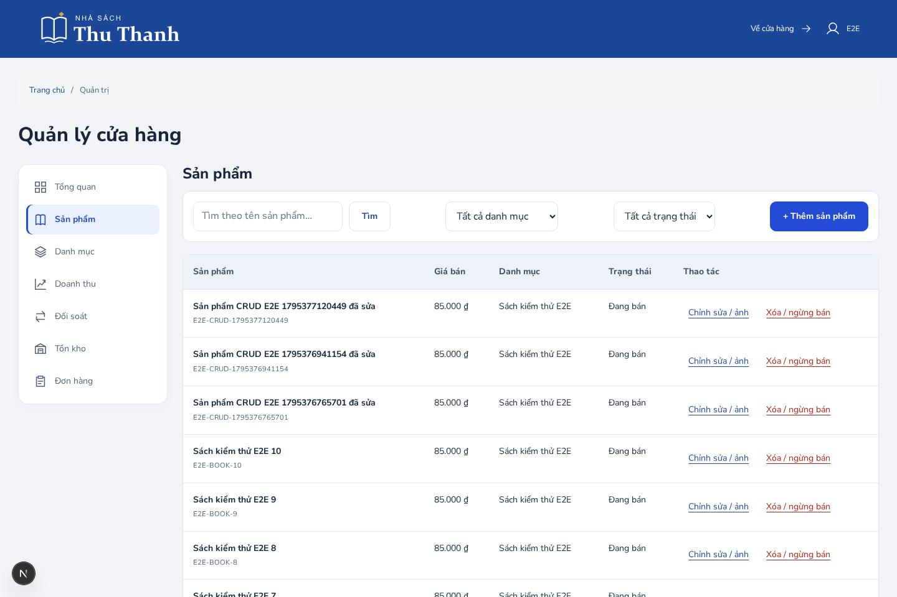

# Nhà sách Thu Thanh

Website bán sách và đồ dùng học tập, gồm cửa hàng trực tuyến và trang quản trị catalog, tồn kho, đơn hàng, thanh toán và doanh thu.

**Website:** [nhasachthuthanh.id.vn](https://nhasachthuthanh.id.vn) · **Repository:** [DongDao27/Thu-Thanh-bookstore](https://github.com/DongDao27/Thu-Thanh-bookstore)

## Chức năng

- Tìm kiếm, lọc danh mục, xem giá và ảnh sản phẩm.
- Đăng ký, đăng nhập, quản lý tài khoản và khôi phục mật khẩu qua email.
- Giỏ hàng, mua ngay, báo giá theo giá/tồn hiện tại; nhận tại cửa hàng hoặc giao hàng.
- Đặt hàng, thanh toán VNPAY Sandbox, xem trạng thái và lịch sử đơn.
- Quản trị sản phẩm, ảnh, danh mục, điều chỉnh tồn, xử lý đơn và báo cáo doanh thu.
- Cập nhật trạng thái bằng polling; Pusher là tùy chọn.

**Thanh toán hiện dùng Sandbox, chưa nhận tiền thật.** Laravel quyết định quyền, giá, tồn và trạng thái thanh toán; trình duyệt không tự xác nhận đã trả tiền.

## Công nghệ

| Thành phần | Công nghệ |
|---|---|
| Frontend | Next.js 16, React 19, JavaScript/JSX, Tailwind CSS |
| Backend | Laravel 12, PHP 8.4, session cookie và CSRF |
| Database | PostgreSQL 17 |
| Hạ tầng | Vercel, Ubuntu VPS, Nginx/PHP-FPM, Cloudflare |
| Email | Resend; queue database |

## Cấu trúc

```text
backend/          Laravel API, migration, dữ liệu chuẩn hóa và tests
frontend/         Next.js, tài nguyên giao diện, unit tests và E2E
```

- `deploy/`: cấu hình container/VPS, worker, scheduler và công cụ vận hành.
- `scripts/`: kiểm thử, kiểm tra dữ liệu và lệnh chạy local.
- `design/figma/`: source plugin thiết kế desktop/mobile và User Flow.
- `data/catalog/`: bảng sản phẩm gốc.
- `docs/`: đặc tả API, database, nghiệp vụ, nguồn ảnh và trạng thái dự án.

## Chạy từ bản clone mới

Yêu cầu: PHP 8.4 + Composer, Node.js 24, PostgreSQL 17 và Python 3 có `venv`. PHP cần PDO PostgreSQL, cURL, mbstring, XML, fileinfo và GD; `composer check-platform-reqs` kiểm tra dependency thực tế. Giao diện Next.js đã được giảng viên chấp nhận theo xác nhận của chủ dự án.

```bash
git clone https://github.com/DongDao27/Thu-Thanh-bookstore.git
cd Thu-Thanh-bookstore
composer install --working-dir=backend
npm ci --prefix frontend
python3 -m venv .venv
.venv/bin/python -m pip install -r scripts/monitoring-requirements.txt
cp backend/.env.example backend/.env
cp frontend/.env.example frontend/.env.local
```

Windows: dùng `py -m venv .venv` và `.venv/Scripts/python.exe` thay cho `.venv/bin/python`. Không cần Docker khi đã cài các công cụ trên.

Tạo role PostgreSQL có mật khẩu riêng và hai database **mới, riêng biệt**. Ví dụ trên Ubuntu, chạy bằng tài khoản quản trị PostgreSQL:

```bash
sudo -u postgres createuser --pwprompt thu_thanh_local
sudo -u postgres createdb --owner=thu_thanh_local thu_thanh_demo
sudo -u postgres createdb --owner=thu_thanh_local thu_thanh_test
```

Có thể tạo cùng role/database bằng pgAdmin trên Windows. Điền `DB_HOST`, `DB_PORT`, `DB_USERNAME`, `DB_PASSWORD` trong `backend/.env`, đặt `DB_DATABASE=thu_thanh_demo`, `APP_ENV=local`. Không dùng database website thật cho các bước này.

```bash
cd backend
php artisan key:generate
php artisan migrate
php artisan db:seed --class=DemoCatalogSeeder
php artisan storage:link
php artisan admin:create
cd ..
```

Seeder demo nạp **24 sản phẩm/6 danh mục có ảnh local**, giá/tồn minh họa; không tải mạng, không tạo tài khoản hoặc đơn hàng. Chỉ chạy trên `thu_thanh_demo`/`thu_thanh_test` với môi trường local/testing; chạy lại không đặt lại giá/tồn đã chỉnh. Admin được tạo tương tác bằng mật khẩu riêng, không có tài khoản mặc định. Khách tự đăng ký trên web.

Mở terminal riêng từ thư mục gốc cho mỗi tiến trình:

```bash
php backend/artisan serve --host=localhost --port=8000
npm run dev --prefix frontend
php backend/artisan queue:work database --tries=5 --timeout=60
```

Web: `http://localhost:3000`; API: `http://localhost:8000`. `frontend/.env.local` đặt `LARAVEL_INTERNAL_URL=http://localhost:8000`. Dùng cùng hostname `localhost` khi đăng nhập để cookie/CSRF hoạt động đúng. Giữ nguyên APP_KEY nếu môi trường đã có dữ liệu.

Mặc định local dùng `MAIL_MAILER=log`, VNPAY hoãn vì chưa có credentials. Luồng giỏ/đặt đơn/quản trị chạy được; thanh toán Sandbox/email thật cần khóa riêng của người chạy. Không copy secrets website vào repo. E2E dùng provider/mail fixture, không cần khóa thật. Website công khai đã kiểm luồng Resend và VNPAY Sandbox/IPN; chưa nhận tiền thật.

## Kiểm thử và coverage

Chuẩn bị cấu hình test riêng, điền role/mật khẩu PostgreSQL vừa tạo trong `backend/.env.testing`; database phải là `thu_thanh_test`. Đặt `OPS_PYTHON_BINARY` trong cả `.env` và `.env.testing` thành **đường dẫn tuyệt đối tới Python trong `.venv`**, ví dụ `/path/Thu-Thanh-bookstore/.venv/bin/python`.

```bash
cp backend/.env.testing.example backend/.env.testing
(cd backend && php artisan key:generate --env=testing)
(cd backend && composer check-platform-reqs && php artisan test)
npm run test:api --prefix frontend
npm run check --prefix frontend
npm run build --prefix frontend
npx --prefix frontend playwright install chromium
node scripts/e2e.mjs
python3 scripts/check-repository.py
```

Chạy backend và E2E **lần lượt**: chúng có quyền tạo lại bảng trong database test. E2E chỉ dùng `thu_thanh_test`, tạo dữ liệu/tài khoản giả riêng và provider fixture; cần cổng 18082/3100 trống. Không chạy `migrate:fresh` trên dữ liệu cửa hàng.

Khi đã cài Xdebug hoặc PCOV, đo coverage:

```bash
(cd backend && XDEBUG_MODE=coverage php artisan test --coverage-clover=storage/logs/coverage.xml)
php scripts/check-coverage.php backend/storage/logs/coverage.xml
php scripts/auth-cookie-smoke.php
php scripts/ops-smoke.php
```

Hai smoke script dùng `.env.testing` và từ chối database khác. GitHub Actions kiểm backend/coverage >70%, frontend và E2E; xem kết quả đúng commit tại tab Actions. Kết quả kiểm hiện hành và giới hạn nằm trong [bảo mật/hiệu năng](docs/SECURITY-PERFORMANCE.md).

## API, logging và monitoring để kiểm bài

- Đăng nhập admin, mở `/docs/api` hoặc `/docs/api.json`: Scramble sinh từ code, chỉ admin được xem. REST version `/api/v1`; [OpenAPI và hợp đồng API](docs/API.md).
- Website dùng session cookie + CSRF. Client ngoài dùng Sanctum PAT có abilities, hết hạn và revoke; không lưu bearer trong localStorage. API cấp token yêu cầu phiên đăng nhập, mật khẩu hiện tại và CSRF; chi tiết trong [API](docs/API.md).
- Sau migration, bật `TELESCOPE_ENABLED=true`, `OPS_MONITORING_ENABLED=true`, đặt `OPS_PYTHON_BINARY` như trên trong `.env` **local**. Chạy `php backend/artisan config:clear`, đăng nhập admin rồi mở `/telescope`; đọc snapshot/cảnh báo tại API `/api/v1/admin/operations` cùng origin. Guest/customer bị chặn; dữ liệu nhạy cảm trong Telescope được lọc.
- Chạy `php backend/artisan ops:monitor` để thu CPU/RAM/disk/network thực. Cảnh báo theo ngưỡng, có cooldown; `OPS_ALERT_EMAIL` tùy chọn, email đi qua queue sau commit. Log tại `backend/storage/logs`; không xuất bản log hoặc `.env`.
- Trên demo local không dùng merchant thật, chạy `php backend/artisan schedule:work` ở terminal riêng để demo expiry/monitor/prune. Không bật scheduler website thật chỉ để kiểm bài. Kiểm slow-query/redaction, HTTP token/CSRF và async bằng test suite/smoke trên DB test.

## Ảnh minh họa và database




Ảnh dùng dữ liệu giả local; không có thông tin khách hàng hoặc khóa dịch vụ.

**[Sơ đồ ERD và thiết kế database](docs/DATABASE.md)**: migrations, khóa ngoại, ràng buộc tiền/tồn và quan hệ bảng. Laravel quyết định giá/tồn/quyền; quote/transaction/row lock và idempotency bảo vệ thao tác đồng thời. Public storefront có cache và invalidation; dữ liệu tài khoản/đơn hàng không chia sẻ cache.

## Tài liệu kỹ thuật

[API](docs/API.md) · [OpenAPI](docs/openapi.json) · [Database](docs/DATABASE.md) · [Nghiệp vụ](docs/DOMAIN-RULES.md) · [Vận hành và bảo mật](docs/SECURITY-PERFORMANCE.md) · [Nguồn tài nguyên](docs/ASSET-SOURCES.md)

## Đối chiếu rubric CSB35050

| Tiêu chí | Bằng chứng trong repo |
|---|---|
| Git/workflow | Issues, topic branches, PR liên kết issue và workflows trong `.github/workflows` |
| Database/seed | [ERD](docs/DATABASE.md), migrations/constraints, factories và `DemoCatalogSeeder` |
| UI/chức năng/API ngoài | Next.js/Tailwind, auth/CSRF/validation; VNPAY Sandbox và Resend; PHPUnit và browser E2E |
| REST API | Resource controllers, Sanctum PAT abilities/expiry/revoke, Scramble và kiểm quyền/ownership |
| Logging/monitoring | Telescope redaction, error envelope/request ID, slow-query alerts, Python CPU/RAM/disk/network |
| Hiệu năng | Database queue sau commit, banner render từ server, ảnh tối ưu/tải theo viewport, cache public + invalidation, pagination/eager loading/indexes và concurrency tests |

Điểm do giảng viên đánh giá. Không dùng số test hoặc Lighthouse để tuyên bố hệ thống an toàn tuyệt đối, chịu tải lớn hoặc đã nhận tiền thật.

## Thành viên

- **Đào Ngọc Đông — [DongDao27](https://github.com/DongDao27):** frontend, thiết kế và tài liệu.
- **Thiện:** backend, database, thanh toán và hạ tầng.

Đăng ký bản tin mới gửi email xác nhận qua queue/mailer hiện hành (Resend khi triển khai, log/array khi phát triển/test). Email trùng không gửi lại; worker cần đang chạy. Không tự gửi campaign hoặc email cho danh sách cũ.
